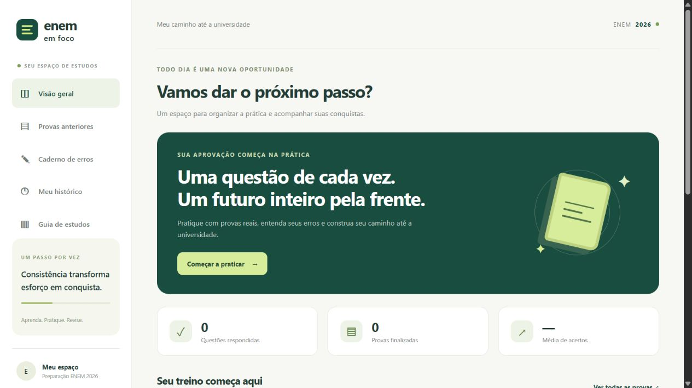

# ENEM em Foco

**V1.1.0** — sistema web de estudos para o ENEM, desenvolvido com Python, SQLite e JavaScript. Contém provas originais, resolução com salvamento automático, correção após entrega, histórico, caderno de erros e VideoAulas. O guia organiza as prioridades do manual de estudos.

## Usar no navegador

A versão online está em **https://enem-em-foco-estudos.eduardocamara2007.chatgpt.site**. O acesso é público e não exige login ou instalação. A aplicação funciona na hospedagem e não depende de manter um computador local ligado.

O código da versão hospedada está em [`hosting/`](hosting/). Provas e vídeos são compartilhados; tentativas, respostas e anotações são separadas por navegador e salvas no banco da hospedagem. Ao limpar os cookies ou trocar de navegador, começa um novo espaço de estudos.

## Executar a versão local

Com Python 3.10 ou superior instalado, execute `iniciar.bat` ou `python server.py` nesta pasta e acesse **http://127.0.0.1:8126**. Mantenha a janela aberta enquanto usa o sistema. Para encerrar, pressione Ctrl+C.

Para começar a partir do GitHub, baixe o ZIP do repositório ou da versão V1.0.0 e extraia a pasta. Também é possível clonar o repositório com Git. Não é necessário instalar as dependências de importação para usar a V1: o catálogo e os materiais já estão incluídos.

Na primeira execução, o sistema cria automaticamente `data/enem.sqlite3` com as seis provas e o histórico vazio. Nas próximas execuções, preserva suas respostas e anotações. O repositório inclui somente `database/catalog.sql`, com provas e gabaritos; o banco pessoal e suas cópias são ignorados pelo Git.

As provas, a correção e o histórico funcionam sem instalar bibliotecas e sem internet depois da importação. Os PDFs e as imagens já estão incluídos. As VideoAulas são reproduzidas pelo YouTube e precisam de internet. Esta versão é para uso pessoal neste computador, sem login ou sincronização. Não há publicação na internet.

## Banco e cobertura

- Banco: `data/enem.sqlite3`; definição das tabelas: `database/schema.sql`.
- 2023, 2024 e 2025, aplicação regular nacional, caderno azul, dias 1 e 2.
- 6 cadernos, 12 PDFs oficiais (prova e gabarito), 192 páginas renderizadas e 555 registros de questões.
- Cada edição tem 180 posições para o idioma escolhido. As 15 questões adicionais correspondem às versões de espanhol das questões 1–5 de cada ano.
- Tabelas: `exams`, `questions`, `attempts`, `answers` e `error_notes`.
- As questões são preservadas nas páginas originais dos PDFs, com referência à página no banco. Não há transcrição independente de enunciados e alternativas: essa escolha preserva fórmulas, gráficos, textos compartilhados e continuações. Há navegação por página e acesso ao PDF completo.
- Inglês e espanhol têm gabaritos separados. São exibidas 90 questões por dia e idioma.
- Anuladas: 2023/2 questão 164; 2024/2 questão 129; 2025/2 questões 123, 132 e 174.
- Reaplicação, PPL, aplicação especial de Belém/Ananindeua/Marituba e versões acessíveis não estão nesta base inicial.

## Correção

O navegador envia respostas ao servidor e não recebe a alternativa correta antes da entrega. O resultado mostra respostas corretas, incorretas, em branco, anuladas e desempenho por área. Questões anuladas são excluídas do denominador; respostas em branco contam entre as questões válidas. O percentual não é uma nota TRI. A redação não recebe correção automática.

O histórico permite retomar tentativas em andamento e consultar correções. Tentativas finalizadas não podem ser alteradas; é possível iniciar outra. Questões respondidas incorretamente entram no caderno de erros, com motivo e anotação editável. As sugestões de revisão são orientações: ainda não há agenda automática ou notificações.

Faça backup de `data/enem.sqlite3` com o servidor fechado para preservar seu histórico e suas anotações. Os gabaritos ficam no servidor; os arquivos do computador continuam acessíveis ao proprietário.

## Fontes e atualização

Índices oficiais consultados em 27/10/2026:

- https://www.gov.br/inep/pt-br/areas-de-atuacao/avaliacao-e-exames-educacionais/enem/provas-e-gabaritos/2023
- https://www.gov.br/inep/pt-br/areas-de-atuacao/avaliacao-e-exames-educacionais/enem/provas-e-gabaritos/2024
- https://www.gov.br/inep/pt-br/areas-de-atuacao/avaliacao-e-exames-educacionais/enem/provas-e-gabaritos/2025

`data/sources.json` registra os links exatos, tamanhos e hashes SHA-256 dos PDFs. `data/import-report.json` resume a validação. O host oficial de arquivos apresentou falha em HTTPS; o downloader tenta a mesma URL pelo HTTP do próprio Inep quando necessário, sem desativar a verificação de certificados.

Para refazer a importação, instale `requirements-import.txt`, execute `python scripts/download_official.py` e depois `python scripts/import_official.py --render`. O download preserva PDFs existentes. Para buscar uma revisão oficial, mova apenas os PDFs que deseja atualizar para uma pasta de backup antes de baixar de novo. A importação atualiza questões sem apagar tentativas e exige correspondência exata entre gabarito e índice de páginas. Se houver histórico, faça backup do banco antes de importar uma nova revisão.

## Verificação

Para testar uma cópia recém-baixada, execute `python -c "from app.storage import initialize; initialize()"` e depois `python -m unittest discover -s tests -v`. Os testes usam cópias temporárias do banco e cobrem os seis cadernos nos dois idiomas, respostas em branco, anuladas, persistência, tentativas finalizadas, criação de um banco novo, preservação do histórico após reinício, catálogo de vídeos e ocultação do gabarito antes da entrega.

O GitHub Actions executa a suíte em Windows e Linux, com Python 3.10 e 3.13, a cada envio de código e pull request. As notas da versão estão em [CHANGELOG.md](CHANGELOG.md), e a atribuição dos materiais em [THIRD_PARTY_NOTICES.md](THIRD_PARTY_NOTICES.md).

Depois de atualizar os materiais oficiais, execute `python scripts/export_catalog.py` para atualizar o catálogo versionado. Esse comando exporta apenas as tabelas de provas e questões; respostas, tentativas e anotações não entram no arquivo.

## VideoAulas

A barra lateral inclui a página `#videoaulas`, com filtros de tipo, edição e área. O catálogo inicial tem 8 aulas de conteúdos prioritários e 6 gravações de correção: duas transmissões por ano, cobrindo Linguagens e Humanas no primeiro dia e Natureza e Matemática no segundo, para 2023, 2024 e 2025.

As aulas são dos canais de Ferretto, Noslen, Paulo Jubilut, Michel (Café com química), Marcelo Boaro, Débora Aladim e Luma e ponto. As correções foram publicadas pelos canais do Estratégia ENEM e Vestibulares (2023 e 2024) e da FTD Educação (2025). As transmissões reúnem equipes de professores e podem usar outra cor de caderno. Não foram reduzidas a clipes ou substituídas por resultados de busca; são links diretos para as gravações integrais disponibilizadas pelos autores.

O player é carregado somente quando o usuário escolhe assistir, pelo domínio `youtube-nocookie.com`. Há um link direto para o YouTube caso a reprodução incorporada não esteja disponível. Ao fechar o diálogo, o player é removido para interromper o vídeo. A aplicação não baixa os vídeos nem carrega conteúdo do YouTube na página inicial.

`data/videos.json` mantém títulos, docentes/canais, áreas, temas, edição e links das fontes. Para conferir os vídeos com a biblioteca `requests` instalada, execute `python scripts/inspect_video_sources.py --catalog`. Esse comando valida a disponibilidade do oEmbed e a correspondência do canal, gravando `data/video-verification.json`; não certifica o conteúdo pedagógico de cada explicação ou a reprodução em todos os países. As fontes foram consultadas em 27/10/2026. As correções em vídeo foram produzidas na época da prova, antes de eventuais anulações, e não alteram o gabarito oficial usado na correção automática.
